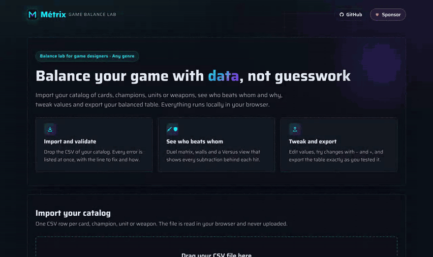

# Métrix — Game Balance Lab

**Balance your game with data, not guesswork.**

**[▶ Try Métrix live](https://javier-treynetcodes.github.io/metrix-game-balance-lab/)** · no install, no account

[](https://github.com/sponsors/javier-treynetcodes)




Métrix is a balance lab for game designers working in any genre: card games, MOBAs, shooters, strategy, RPGs and board games. Import the catalog of your game (cards, champions, units, weapons, enemies) and Métrix shows you what spreadsheets hide:

- **Clones** *(coming soon)*: entities that do almost the same thing.
- **Off-curve entities** *(coming soon)*: too strong or too weak for their cost.
- **Duel outcomes:** who beats whom one-on-one, by how much and why.
- **Walls:** entities that some attackers cannot damage at all.

Everything runs locally in your browser. Your data is never uploaded and there is no account to create.

## How to use Métrix

### 1. Get the template

Open Métrix and choose **Download template** or **Copy template**. To look around before preparing your own file, choose **Try with example data**. The template is a CSV file with eight invented characters across the six usual MOBA classes (tank, fighter, mage, marksman, assassin and support) and one complement per class. Each class has its own attack speed and move speed, and three complements raise them. It is balanced so every character wins some duels and loses others, by hits and by time, and the complements change who wins some of them:

```csv
id,kind,name,character,class,cost,hp,speed,move,atk:channel1,def:channel1,atk:channel2,def:channel2,tag:role
vanguard,unit,Iron Vanguard,Aria,tank,45,600,95,90,30,30,0,10,frontline
duelist,unit,Blade Duelist,Kael,fighter,47,500,105,100,26,20,26,12,frontline
archer,unit,Long Archer,Lysa,marksman,44,400,125,105,50,6,0,6,backline
shadow,unit,Night Shadow,Vex,assassin,46,380,110,120,54,10,0,8,flank
sorcerer,unit,Storm Sorcerer,Nyra,mage,49,440,105,100,0,10,42,20,backline
oracle,unit,Dawn Oracle,Sera,support,44,440,95,100,0,16,30,24,backline
warden,unit,Rune Warden,Toren,tank,48,640,90,85,0,26,28,14,frontline
witch,unit,Ember Witch,Mira,mage,42,320,95,105,0,8,44,18,flank
shield,complement,Tower Shield,,tank,,,,,,2,,10,
blade,complement,Twin Blade,,fighter,,,,10,10,,,,
bow,complement,Hunter Bow,,marksman,,,10,,6,,,,
dagger,complement,Venom Dagger,,assassin,,,5,,6,,,,
staff,complement,Arcane Staff,,mage,,,,,,,2,,
charm,complement,Ward Charm,,support,,,,,,8,,2,
```

### 2. Fill it with your catalog

Replace the example rows with your own, one per row. The `kind` column says what each row is:

- `unit`: a character, unit, card or enemy of your catalog. Rows without `kind` (or files without the column) are units.
- `complement`: an item obtained during a match that adds attack or armor to **every character of one class**.
- `rule`: how much of each channel an armor stops (see *Armor coverage* below). Optional.

**Every game value is a whole number of 0 or more**: no decimals or units.

| Column | Required | In `unit` rows | In `complement` rows |
| --- | --- | --- | --- |
| `id` | Yes | A unique identifier without spaces, e.g. `iron-vanguard`. | A unique identifier, e.g. `tower-shield`. |
| `kind` | No | `unit` (or empty). | `complement`. |
| `name` | Yes | The kind of unit, e.g. `Iron Vanguard`. | The name of the complement, e.g. `Tower Shield`. |
| `character` | No | The character's own name, e.g. `Aria`. | Empty. |
| `class` | No* | The class, e.g. `tank`. | *Required: the class that receives it. |
| `cost` | No | Gold, mana, level… | Empty. |
| `hp` | No | Health, at least 1. Needed to count hits to defeat. | Empty. |
| `speed` | No | Attack speed as a whole percentage where 100 is normal, at least 1. If any unit has it, every unit needs it. | Speed it adds, or empty. |
| `move` | No | Move speed as a whole percentage where 100 is normal, at least 1. Informative: it never changes who wins. If any unit has it, every unit needs it. | Move it adds, or empty. |
| `atk:<channel>` | No | Attack on that channel. Values on both channels make a **mixed attack**. | Attack it adds. |
| `def:<channel>` | No | Armor on that channel. | Armor it adds. |
| `tag:<name>` | No | Text labels, e.g. `tag:role` with `frontline`. | Empty. |
| Any other column | No | Extra whole-number stats (range, crit…). Other columns are kept as they are and exported back untouched. | Empty. |

#### How damage works

1. **Attack on one or both channels.** A mixed attacker (attack on both) works out each channel on its own and adds the results.
2. **Damage = attack − armor against it**, never below 0.
3. **Armor coverage:** by default each armor only stops its own channel, so `def:channel1` does nothing against `atk:channel2`. You can make an armor also stop a share of the other channel.
4. **No armor against a channel = full damage** on that channel.
5. **Complements add their bonuses** to every character of their class. Duels and Versus compare base values and values with complements.

```
Mixed attacker: atk:channel1 = 30 · atk:channel2 = 25
Defender:       def:channel1 = 20 · def:channel2 = 5
Coverage:       channel 1 armor also stops 20 % of channel 2

Channel 1: 30 − 20                   = 10
Channel 2: 25 − (20 × 20 % + 5) = 25 − 9 = 16
Per hit:   10 + 16                   = 26
```

#### Speed and movement

Both columns are optional: leave them empty and Métrix works as before. They are percentages where **100 is normal**, so `125` is 25 % faster and `90` is 10 % slower. Complements can only add to them.

- **Attack speed (`speed`)** changes the duel. With it, Métrix adds the **Time to defeat** measure: `hits × 100 ÷ speed`. An archer that needs 20 hits at 125 % speed takes `20 × 100 ÷ 125 = 16.0`, faster than a tank that needs 18 hits at 90 % (`20.0`). Fewer wins. Times are compared exactly and shown with one decimal.
- **Move speed (`move`)** does not change who wins: Métrix does not simulate positions. It adds informative notes instead: a winner that moves faster can chase the loser down, and a loser that moves faster can escape the fight or avoid it. When the difference is under 10 points the note says *slightly* faster.

#### Armor coverage

Set it in the **Damage rules** tab: one row per armor, one column per attack, each cell a whole percentage from 0 to 100. The armor against a channel is added up and **rounded down**, so results stay whole numbers. When the coverage is not the default, the exported CSV keeps it in two `rule` rows whose `id` is the channel and whose `def:` columns are the percentages that armor stops:

```csv
id,kind,name,atk:channel1,def:channel1,atk:channel2,def:channel2
channel1,rule,Channel 1 armor,,100,,20
channel2,rule,Channel 2 armor,,0,,100
```

#### Damage channels

Métrix works with **two damage channels**. The template names them `channel1` and `channel2`, shown as "Channel 1" and "Channel 2". Give them your game's names by editing the column headers (`atk:channel1` → `atk:physical`…), or rename them in the **Damage rules** tab: the exported CSV uses the new names.

| Genre | Typical channels |
| --- | --- |
| MOBA, action RPG | `physical`, `magic` |
| Shooter | `ballistic`, `energy` |
| Card game | `combat`, `spell` |
| Strategy | `melee`, `ranged` |
| Tower defense | `ground`, `air` |

Tips:

- Wrap text that contains commas in double quotes: `"Iron Vanguard, Elite"`.
- Empty `atk:` and `def:` cells count as 0.
- Files using `;` or tabs as separator are detected automatically.

### 3. Import the file

Drag the CSV into Métrix or choose **Choose CSV file**. To replace a loaded catalog, choose **Import another file**. Métrix checks the whole file before importing anything:

- **Errors** block the import completely: no data is loaded until every error is fixed. All errors are listed at once, each with the lines to fix and how to fix it.
- **Warnings** let the import continue: columns Métrix does not analyze are kept as they are, entities without `hp` cannot be defeated, speeds above 300 % are flagged as a likely typo, and speed or move bonuses are flagged when no unit has that stat.

If the file has quote errors, only those are listed, because they shift every following cell. Fix them and import again to see any remaining errors.

### 4. Choose your genre

After importing, tell Métrix what kind of game it is. The genre decides which measure ranks duels and how results are explained; your data and the damage rules never change, and you can switch genre at any time.

| Genre | Duels ranked by |
| --- | --- |
| Card game | Trade |
| Shooter | Shots to defeat (time to defeat when the file has `speed`) |
| Turn-based RPG | Hits to defeat |
| MOBA / Action | Hits to defeat (time to defeat when the file has `speed`) |
| Board game | Trade |
| Other | Your choice |

The measures:

- **Hits to defeat:** how many hits (shots, attacks) one entity needs to bring the other to 0 hp. Fewer wins; the same number is a draw.
- **Time to defeat:** only when the file has `speed`. Hits to defeat adjusted by attack speed (`hits × 100 ÷ speed`). Fewer wins; the same time is a draw.
- **Damage per hit:** damage of one hit after the defender's defense. More wins.
- **Trade:** damage dealt minus damage received when both hit once. Positive wins.
- **Damage blocked:** how much of an attack the defense stops. It describes armor and names no winner.

### 5. Work with your catalog

- **Catalog:** click any value to edit it, and add, duplicate or delete entities. Changes are highlighted, can be undone (Ctrl/Cmd+Z) and reverted all at once. New columns are added in the file, from the template.
- **Damage rules:** how damage works, the armor coverage, your channel names, and which entities some attacks hit in full.
- **Complements:** every complement by class, with its bonuses and the characters that receive it. Switch complements on or off to see which one changes the balance; this only affects the view and the CSV keeps them all.
- **Duels:** every entity against every other one, ranked by the genre's measure or the one you pick, with each entity's win–loss record. Switch between **Base** and **With complements**; a ◆ marks the duels whose winner changes. Close fights are marked, **Walls** lists the entities some attackers cannot damage at all, with the reason, and, when the file has `move`, **Escapes** lists the losers that move faster than their winner.
- **Versus:** pick two entities and see who is stronger, why, and the subtraction behind every hit. With `speed` it also shows the time to defeat, and with `move` a **Movement** note on who can chase or escape. Each side can fight **with complements**, and every bonus appears with the name of its complement. Use − and + to try changes and **Apply to catalog** when you like them.
- **Export CSV:** download your catalog as you left it in Métrix, with the same columns, order and separator as your file, ready to import again.
- **Galaxy** and **cost/power curve** *(coming soon)*.

## Cleaning your CSV

Most import errors come from how a spreadsheet saved the file. Open the CSV in a plain text editor to see exactly what Métrix reads.

### Structure and quotes

| Error | Example | Fix |
| --- | --- | --- |
| More cells than the header | `vanguard,Iron Vanguard, Elite,45` | Text that contains the separator must be wrapped in double quotes: `vanguard,"Iron Vanguard, Elite",45`. |
| Fewer cells than the header | `vanguard,unit,Iron Vanguard` when the header has 12 columns | Every row needs one cell per column. Keep the separators of empty cells. |
| Quote never closed | `vanguard,"Iron Vanguard,45` | Add the closing quote: `vanguard,"Iron Vanguard",45`. |
| Quote inside an unquoted value | `cannon,12" Cannon,30` | Wrap the value in quotes and double the inner quote: `cannon,"12"" Cannon",30`. |
| Duplicate column | `hp` and `HP` in the header | Column names are not case-sensitive. Keep one and delete the other. |
| Missing required column | No `id` or `name` in the header | Add the column to the header row, as in the template. |
| More than two channels | `atk:1`, `atk:2` and `atk:3` | Keep two channels. An entity can attack on both at once. |
| Retired column: `category` | `category` in the header | It is now called `class`: rename the header. |
| Retired columns: hybrid | `atk:hybrid:1`, `def:hybrid:2` | Move hybrid attack values into the `atk:` column of each channel (an entity can attack on both), delete the hybrid columns, and set the armor coverage in **Damage rules** instead of hybrid armor. |

### Values

| Error | Example | Fix |
| --- | --- | --- |
| Not a whole number | `48.5`, `600 hp`, `-10`, `N/A` | Write whole numbers of 0 or more: `48`, `600`. Leave the cell empty if there is no value. |
| HP of 0 | `hp` = `0` | HP must be at least 1. Leave it empty if the entity cannot be defeated. |
| Speed or move of 0 | `speed` = `0` | They are percentages where 100 is normal: write a whole number of 1 or more, e.g. `110`. |
| Missing speed or move | Some units have `speed` and others leave it empty | If any unit has the column, every unit needs a value. Leave the whole column empty if your game does not use it. |
| Missing `id` or `name` | `,Iron Vanguard,45` | Every row needs both. |
| Id with spaces | `iron vanguard` | Use hyphens: `iron-vanguard`. |
| Duplicate id | Two rows with `vanguard` | Every id must be unique across units, complements and rules, e.g. `vanguard` and `vanguard-elite`. |
| Unknown `kind` | `boss` | Use `unit`, `complement` or `rule`, or leave it empty for units. |
| Complement without `class` | `shield,complement,Tower Shield,,,…` | Write the class that receives it, e.g. `tank`. |
| Complement with unit data | A complement with `hp`, `cost`, `character` or `tag:` | Complements only use `id`, `kind`, `name`, `class`, the `atk:`/`def:` bonuses and the `speed`/`move` bonuses. Leave the rest empty. |
| Rule for an unknown channel | `fire,rule,…` when the channels are `channel1` and `channel2` | A rule row's `id` is the channel whose armor it describes. |
| Coverage above 100 | `def:channel2` = `120` in a rule row | Coverage is a whole percentage from 0 to 100. |

### Saving from a spreadsheet

- Save as **CSV (comma-separated)** or **CSV UTF-8**. Other formats are not supported.
- Remove totals, notes and merged cells: the file must contain only the header row and one row per entity.
- Remove thousands separators before saving (`1,200` → `1200`): format numeric columns as plain numbers.

## Support Métrix

Métrix is free to use. If it helps you balance your game, consider [sponsoring its development on GitHub](https://github.com/sponsors/javier-treynetcodes): sponsorships fund the next analyses, like the cost/power curve and the galaxy map.

## Privacy

Métrix processes your catalog inside your browser. Nothing is sent to any server, there are no accounts and no tracking cookies. The last imported catalog, with your edits, is kept in your browser's local storage so it survives a reload; **Clear data** removes it.

## Development

Requires Node.js 20 or later.

```bash
npm install         # install every workspace
npm run dev         # web app at http://localhost:5173/metrix-game-balance-lab/
npm run check       # lint, type check, tests (100% coverage required) and build, as in CI
```

`dev` is the working branch; every push to `prod` deploys the web app to GitHub Pages.
